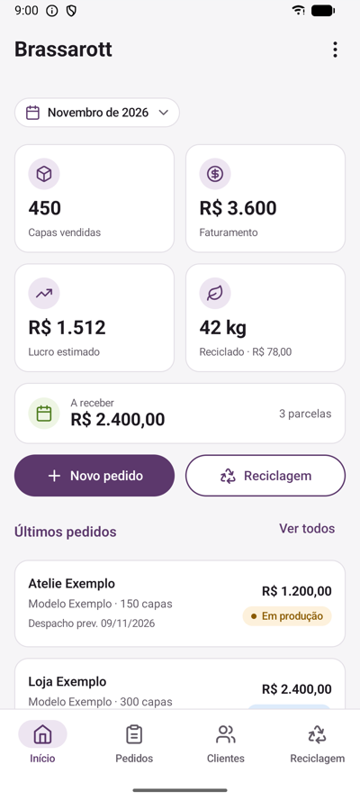
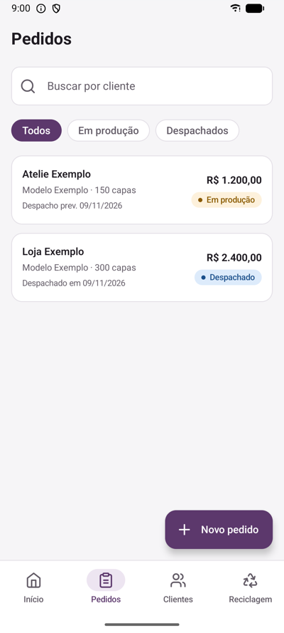
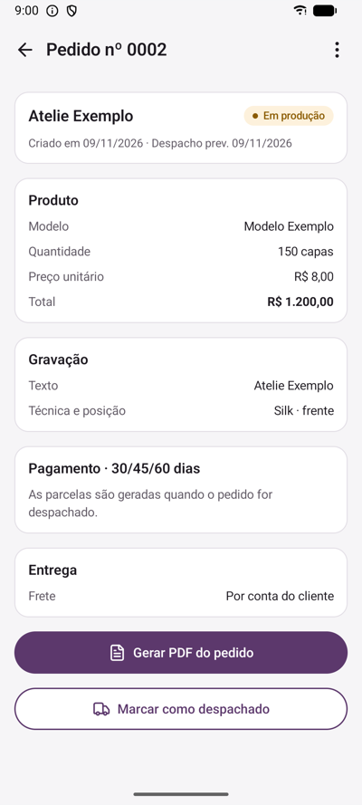
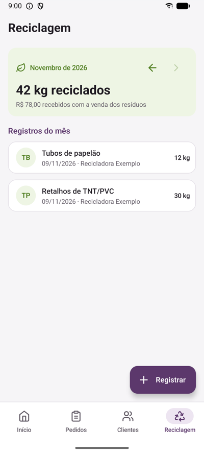

# confeccao-app

App Android para organizar os pedidos de uma pequena confecção. Feito em uma ação de extensão da UFMS Digital com uma microempresa de Sumaré/SP que fabrica capas para ternos.

   

## O que o app faz

- Cadastro de clientes e de modelos de capa
- Pedidos com geração de PDF para enviar ao cliente
- Parcelas calculadas a partir da data de despacho
- Registro do material vendido para reciclagem
- Resumo do mês na tela inicial

## Como rodar

1. Crie um projeto no Firebase, adicione um app Android com o pacote `io.github.larissafzl.confeccao` e coloque o `google-services.json` na pasta `app/`.
2. Ative o login por e-mail e senha, cadastre os usuários e publique as regras do arquivo `firestore.rules` no Firestore.
3. Abra o projeto no Android Studio e rode em um aparelho com Android 8.0 ou superior.

Para usar em outra confecção, troque o nome e os dados da empresa em `strings.xml` e as cores em `Color.kt`.

## Créditos

Ícones da biblioteca [Lucide](https://lucide.dev) (licença ISC).

## Licença

MIT
